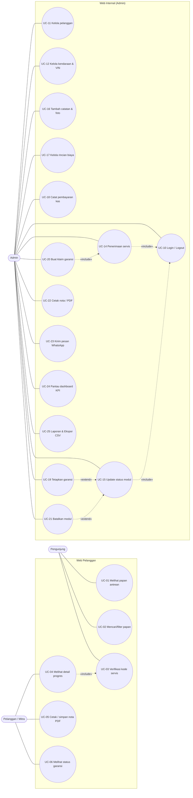

# 03 — Use Case

## 1. Diagram Use Case

Diagram di bawah mengikuti sintaks Mermaid serta selaras dengan sumber PlantUML pada [`diagrams/use-case.puml`](diagrams/use-case.puml).

> Pelanggan adalah Pengunjung yang sudah lolos verifikasi UC-03. Fitur `Kelola Jenis Modul` (`UC-13`) dan `Kelola Akun Admin` (`UC-26`) pada rancangan awal dikecualikan dari UI final dan digantikan oleh mekanisme *database seeding*. Seluruh use case internal mensyaratkan sesi login `UC-10`.

## 2. Skenario Use Case Utama

### UC-03 Verifikasi Kode Servis
| Elemen | Isi |
|---|---|
| Aktor | Pengunjung |
| Prakondisi | Servis dengan kode tersebut ada |
| Pemicu | Klik kartu di papan / buka tautan `/cek/[code]` dari pesan WhatsApp atau nota cetak |
| Alur utama | 1. Sistem menampilkan form kode (4 digit) & 4 digit akhir HP (kode terisi otomatis bila berasal dari `/cek/[code]` atau `/cek?code=`). 2. Pengunjung mengisi lalu menekan **Buka Progres**. 3. Sistem mencocokkan kode + 4 digit akhir HP pada `service_orders`. 4. Sistem menetapkan cookie HMAC `track_session_<publicId>` dan mengarahkan ke `/track/[publicId]` (UC-04) |
| Alur alternatif | 3a. Tidak cocok: sistem menampilkan pesan generik "Kode atau nomor tidak cocok", lalu kembali ke langkah 1. 2a. Format bukan 4 digit angka: validasi di sisi klien & server |
| Pascakondisi | Pengunjung menjadi Pelanggan untuk servis itu |
| Ref | FR-P05, FR-P06, FR-P13, BR-02 |

> Catatan: kartu papan hanya membawa **ID publik acak** (bukan kode servis). Jika verifikasi dimulai dari kartu, sistem memeriksa bahwa kode + 4 digit HP cocok **dengan servis pada kartu itu**, sehingga kode tetap berfungsi sebagai kunci.

### UC-04 Melihat Detail Progres
| Elemen | Isi |
|---|---|
| Aktor | Pelanggan |
| Prakondisi | Lolos UC-03 |
| Alur utama | 1. Sistem menampilkan ringkasan servis (mobil, tanggal masuk, estimasi selesai). 2. Untuk tiap modul: status, progress bar, timeline catatan & media publik. 3. Rincian biaya, pembayaran, status bayar. 4. Garansi per modul (bila ada). 5. Tombol unduh nota/invoice |
| Alur alternatif | 2a. Belum ada catatan: tampil "Unit telah diterima, menunggu diagnosa". 4a. Ada klaim garansi tertaut: tampil tautan "Servis asal" atau "Klaim garansi" |
| Ref | FR-P07 – FR-P12, BR-10 |

### UC-14 Penerimaan Servis
| Elemen | Isi |
|---|---|
| Aktor | Admin |
| Prakondisi | Admin login |
| Alur utama | 1. Admin mencari pelanggan via No. HP. 2. Jika ada, sistem menampilkan pelanggan + kendaraannya; jika tidak ada, admin membuat pelanggan baru. 3. Admin memilih/membuat kendaraan, atau memilih "Modul saja" tanpa kendaraan. 4. Admin mengisi jenis penerimaan, cara masuk (+ No. resi bila ekspedisi), estimasi selesai, catatan kondisi. 5. Admin menambah ≥ 1 modul (jenis, detail, keluhan). 6. Admin menyimpan. 7. Sistem membuat kode 4 digit unik, status modul `DITERIMA`, entri timeline pertama. 8. Sistem menampilkan halaman servis dengan tombol **Nota PDF** & **Kirim via WhatsApp** |
| Alur alternatif | 5a. Tanpa modul: simpan ditolak. 7a. Kode bentrok: sistem mengulang acak. 7b. Kapasitas kode < 10%: tampil peringatan |
| Ref | FR-S01 – FR-S03, FR-S13, FR-S15, BR-01 |

### UC-15 Update Status Modul
| Elemen | Isi |
|---|---|
| Aktor | Admin |
| Alur utama | 1. Admin membuka halaman Servis (`/admin/services`) lalu membuka tab Pengerjaan pada modul terpilih. 2. Sistem mengunci tombol tahap yang melanggar transisi terurut (BR-03). 3. Admin memilih tahap tujuan yang valid, opsional menambahkan catatan atau foto tahap. 4. Sistem memvalidasi melalui `/api/dataset` dan menyimpan riwayat timeline ke PostgreSQL |
| Alur alternatif | 3a. Pilih `BATAL`: alasan pembatalan wajib diisi (UC-21 / `FR-S10`). 3b. Pilih `SELESAI` padahal `remaining > 0`: ditolak kecuali admin mengisi alasan override (`BR-06`). 3c. Pilih `SIAP_DIAMBIL` / `SELESAI`: sistem menghitung `warrantyUntil` otomatis dari durasi `warrantyMonths` (UC-19) |
| Ref | FR-S04, FR-S09, FR-S10, BR-03, BR-06 |

### UC-16 Tambah Catatan & Foto Bukti
| Elemen | Isi |
|---|---|
| Aktor | Admin |
| Alur utama | 1. Admin menuliskan catatan teknis per tahap. 2. Admin opsional mengunggah foto JPG/PNG/WebP yang dikompres di browser lalu diunggah ke `POST /api/media` (`/api/media/YYYY/MM/<uuid>.<ext>`). 3. Admin mengatur toggle `Tampil ke Pelanggan` (Publik) atau `Internal Saja` (Privat) pada catatan maupun daftar linimasa. 4. Foto berstatus `Internal Saja` diblokir oleh `GET /api/media/[...path]` (`403 Forbidden`) untuk akun non-admin dan tidak tampil di `/track/[publicId]` |
| Alur alternatif | 2a. Berkas bukan gambar atau ukuran melebihi 2 MB: ditolak dengan pesan galat |
| Ref | FR-S05, FR-S06, NFR-02, BR-10 |

### UC-17 & UC-18 Kelola Biaya dan Pembayaran
| Elemen | Isi |
|---|---|
| Aktor | Admin |
| Alur utama | 1. Admin menambah item (jenis, deskripsi, qty, harga, opsional terkait modul). 2. Sistem menghitung ulang total & status bayar. 3. Saat pelanggan membayar, admin mencatat nominal, metode, tanggal. 4. Sistem memperbarui status bayar (BR-05) |
| Alur alternatif | 1a. Servis terkunci (BR-07): item tidak bisa diubah. 3a. Nominal ≤ 0: ditolak |

### UC-20 Klaim Garansi
| Elemen | Isi |
|---|---|
| Aktor | Admin |
| Alur utama | 1. Admin membuka servis lama (cari via kode/HP). 2. Admin memilih modul bergaransi aktif → **Klaim Garansi**. 3. Sistem membuat servis baru (kode baru) yang tertaut ke servis asal, dengan pelanggan/kendaraan/modul tersalin dan label *Klaim Garansi*. 4. Alur berlanjut seperti UC-14 langkah 7–8 |
| Alur alternatif | 2a. Garansi habis: tombol nonaktif, admin bisa membuat servis biasa |
| Ref | FR-S11, BR-08 |
