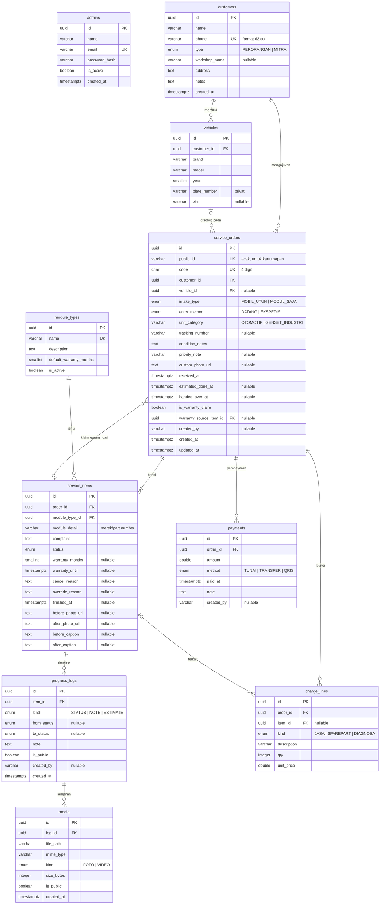

# 05 — ERD & Kamus Data

DBMS: **PostgreSQL 18** (lokal produksi `multitech_db`) / **PostgreSQL 16** (`docker-compose.yml`), diakses lewat **Prisma ORM** ([prisma/schema.prisma](../prisma/schema.prisma)). Mode fallback JSON read-only dinonaktifkan pada admin (`ALLOW_OFFLINE_ADMIN_FALLBACK="false"`).

## 1. ERD (Mermaid Sinkron Schema Aktual)

## 2. Enum

| Enum | Nilai |
|---|---|
| `customer_type` | `PERORANGAN`, `MITRA` |
| `intake_type` | `MOBIL_UTUH`, `MODUL_SAJA` |
| `entry_method` | `DATANG`, `EKSPEDISI` |
| `item_status` | `DITERIMA`, `DIAGNOSA`, `MENUNGGU_PERSETUJUAN`, `MENUNGGU_SPAREPART`, `PERBAIKAN`, `UJI_QC`, `SIAP_DIAMBIL`, `SELESAI`, `BATAL` |
| `log_kind` | `STATUS`, `NOTE`, `ESTIMATE` |
| `media_kind` | `FOTO`, `VIDEO` |
| `charge_kind` | `JASA`, `SPAREPART`, `DIAGNOSA` |
| `payment_method` | `TUNAI`, `TRANSFER`, `QRIS` |

## 3. Kamus Data

### `customers`
| Kolom | Tipe | Null | Keterangan |
|---|---|---|---|
| id | uuid | ✗ | PK |
| name | varchar(100) | ✗ | Nama pelanggan / PIC bengkel |
| phone | varchar(16) | ✗ | Unik, E.164 tanpa `+` (contoh `6281234567890`). 4 digit terakhir dipakai untuk verifikasi |
| type | customer_type | ✗ | Default `PERORANGAN` |
| workshop_name | varchar(100) | ✓ | Wajib bila `type = MITRA` |
| address | text | ✓ | |
| notes | text | ✓ | Catatan internal |

### `vehicles`
| Kolom | Tipe | Null | Keterangan |
|---|---|---|---|
| customer_id | uuid | ✗ | FK → customers |
| brand | varchar(50) | ✗ | Contoh: Toyota |
| model | varchar(50) | ✗ | Contoh: Avanza |
| year | smallint | ✓ | |
| plate_number | varchar(15) | ✓ | **Privat**, tidak pernah tampil di web publik |
| vin | varchar(20) | ✓ | Nomor rangka |

> Untuk mitra, kendaraan disimpan di bawah pelanggan mitra (kendaraan milik pelanggan si bengkel).

### `module_types`
| Kolom | Tipe | Null | Keterangan |
|---|---|---|---|
| name | varchar(50) | ✗ | Unik. Seed: ECU, BCM, EPS, Speedometer/Cluster, ABS, Airbag (SRS), TCM, Immobilizer, Lainnya |
| default_warranty_months | smallint | ✓ | Saran garansi default saat modul selesai |
| is_active | boolean | ✗ | Nonaktif = tidak muncul di pilihan baru |

### `service_orders`
| Kolom | Tipe | Null | Keterangan |
|---|---|---|---|
| public_id | varchar | ✗ | Unik, acak (`nanoid`). Dipakai pada kartu papan publik (`/track/[publicId]`) |
| code | char(4) | ✗ | Unik, angka acak `0000`–`9999`, permanen (`BR-01`) |
| customer_id | uuid | ✗ | FK → `customers` |
| vehicle_id | uuid | ✓ | Null bila modul saja tanpa data kendaraan |
| intake_type | intake_type | ✗ | `MOBIL_UTUH` atau `MODUL_SAJA` |
| entry_method | entry_method | ✗ | `DATANG` atau `EKSPEDISI` |
| unit_category | varchar | ✗ | Default `OTOMOTIF` (`OTOMOTIF` atau `GENSET_INDUSTRI`) |
| tracking_number | varchar | ✓ | No. resi bila `entry_method = EKSPEDISI` |
| condition_notes | text | ✓ | Kondisi fisik saat diterima |
| priority_note | text | ✓ | Pengingat tindak lanjut prioritas di Dashboard Admin |
| custom_photo_url | text | ✓ | Foto unit kustom unggahan (`/api/media/...`) |
| received_at | timestamptz | ✗ | Default `now()` |
| estimated_done_at | timestamptz | ✓ | Estimasi selesai (`DateTime?`) |
| handed_over_at | timestamptz | ✓ | Waktu serah terima, dasar hitung garansi |
| is_warranty_claim | boolean | ✗ | Default `false` |
| warranty_source_item_id | uuid | ✓ | FK → `service_items` (`"WarrantyClaims"`) |
| created_by | text | ✓ | Email admin pencatat |

### `service_items`
| Kolom | Tipe | Null | Keterangan |
|---|---|---|---|
| order_id | uuid | ✗ | FK, `ON DELETE CASCADE` |
| module_type_id | uuid | ✗ | FK → `module_types` |
| module_detail | varchar | ✓ | Contoh: `"Bosch ME17.9.11"` |
| complaint | text | ✗ | Keluhan |
| status | item_status | ✗ | Default `DITERIMA` |
| warranty_months | int | ✓ | Durasi garansi dalam bulan |
| warranty_until | timestamptz | ✓ | Dihitung via `computeWarrantyUntil` (`DateTime?`) |
| cancel_reason | text | ✓ | Wajib bila `BATAL` (`FR-S10`) |
| override_reason | text | ✓ | Alasan wajib menutup `SELESAI` sebelum lunas (`BR-06`) |
| finished_at | timestamptz | ✓ | Waktu mencapai status final |
| before_photo_url | text | ✓ | Foto kondisi awal publik |
| after_photo_url | text | ✓ | Foto hasil akhir publik |
| before_caption | text | ✓ | Keterangan foto *Before* |
| after_caption | text | ✓ | Keterangan foto *After* |

### `progress_logs`
| Kolom | Tipe | Null | Keterangan |
|---|---|---|---|
| item_id | uuid | ✗ | FK → `service_items` (`ON DELETE CASCADE`) |
| kind | log_kind | ✗ | `STATUS`, `NOTE`, atau `ESTIMATE` |
| from_status / to_status | item_status | ✓ | Status asal dan status tujuan |
| note | text | ✓ | Catatan tahap pengerjaan |
| is_public | boolean | ✗ | Default `true`; `false` menyembunyikan log & media terkait dari pelanggan |
| created_by | text | ✓ | Email admin pembuat catatan |

### `media`
| Kolom | Tipe | Null | Keterangan |
|---|---|---|---|
| log_id | uuid | ✗ | FK → `progress_logs` (`ON DELETE CASCADE`) |
| file_path | varchar | ✗ | Path API (`/api/media/YYYY/MM/<uuid>.<ext>`) |
| mime_type | varchar | ✗ | `image/jpeg`, `image/png`, `image/webp` |
| kind | media_kind | ✗ | Saat ini aktif `FOTO` (`MediaKind.FOTO`) |
| size_bytes | integer | ✗ | Validasi server maksimal `2 MB` |
| is_public | boolean | ✗ | Sinkron dengan status publik log saat disimpan |

### `charge_lines`
| Kolom | Tipe | Null | Keterangan |
|---|---|---|---|
| order_id | uuid | ✗ | FK → `service_orders` (`ON DELETE CASCADE`) |
| item_id | uuid | ✓ | Modul terkait (opsional) |
| kind | charge_kind | ✗ | `JASA`, `SPAREPART`, `DIAGNOSA` |
| description | varchar | ✗ | Contoh: `"IC Driver Ignition Coil Bosch + Pasang"` |
| qty | integer | ✗ | ≥ 1 |
| unit_price | float | ✗ | Nominal rupiah (`≥ 0`) |

### `payments`
| Kolom | Tipe | Null | Keterangan |
|---|---|---|---|
| order_id | uuid | ✗ | FK → `service_orders` (`ON DELETE CASCADE`) |
| amount | float | ✗ | Nominal rupiah (`> 0`) |
| method | payment_method | ✗ | `TUNAI`, `TRANSFER`, atau `QRIS` |
| paid_at | timestamptz | ✗ | Tanggal pembayaran diterima |
| created_by | text | ✓ | Email kasir/admin pencatat |

## 4. Nilai Turunan (tidak disimpan)
| Nilai | Rumus |
|---|---|
| Total biaya | `SUM(qty * unit_price)` dari `charge_lines` |
| Total dibayar | `SUM(amount)` dari `payments` |
| Status bayar | BR-05 |
| Status servis | Aktif bila ada `service_items.status NOT IN (SELESAI, BATAL)` |
| Status garansi | `warranty_until >= CURRENT_DATE` → Berlaku |

## 5. Indeks
| Tabel | Indeks | Alasan |
|---|---|---|
| service_orders | `UNIQUE(code)`, `UNIQUE(public_id)` | Verifikasi & kartu publik |
| customers | `UNIQUE(phone)` | Pencarian admin |
| service_items | `(status)`, `(order_id)` | Papan publik & kanban |
| progress_logs | `(item_id, created_at)` | Timeline |
| payments, charge_lines | `(order_id)` | Hitung total |
