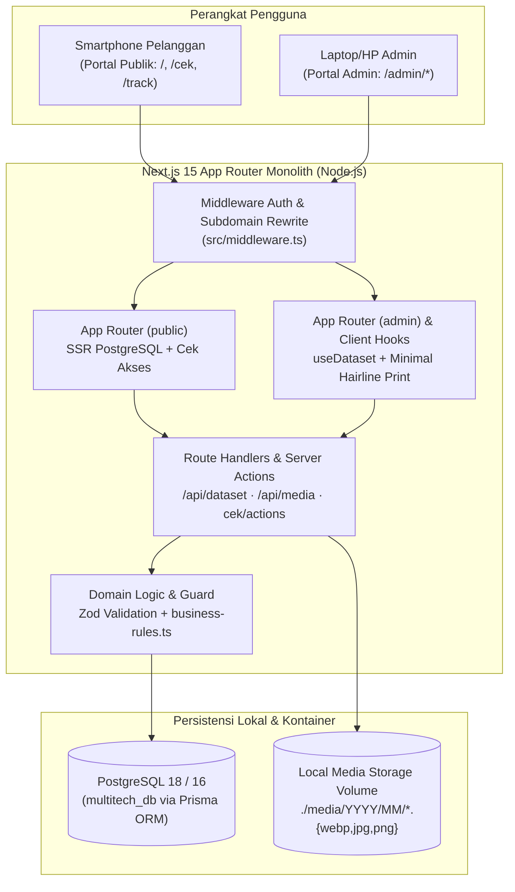
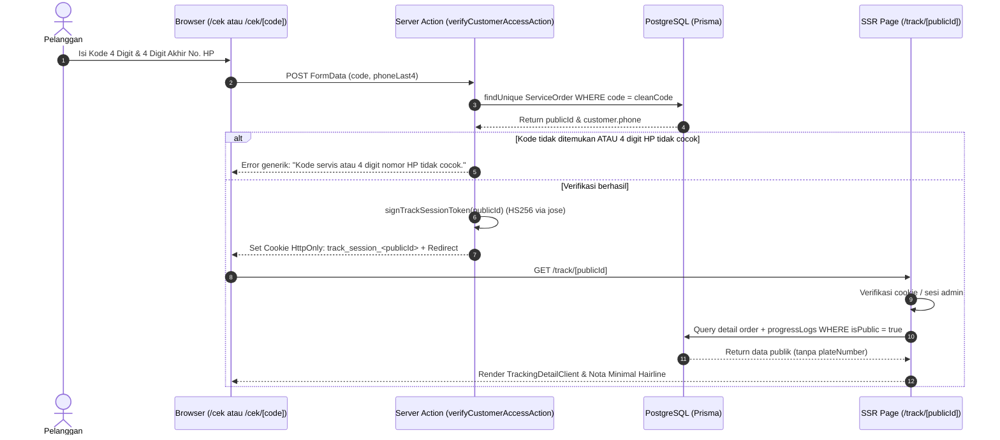
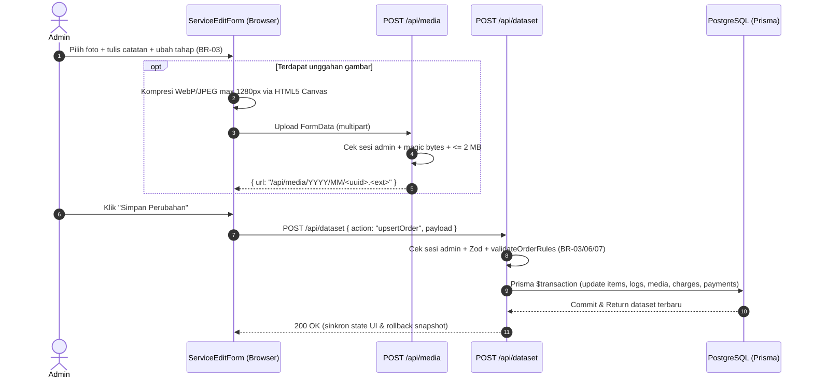

# 06 — Arsitektur Sistem & Infrastruktur

## 1. Ikhtisar Arsitektur (C4 & Container View)
Sistem Multitech dikembangkan menggunakan arsitektur **Monolith Modular** berbasis Next.js 15 App Router (TypeScript). Antarmuka Publik Pelanggan dan Portal Internal Admin berada dalam satu repositori dan satu basis data PostgreSQL, dipisahkan pada lapisan perutean melalui `src/middleware.ts` (akses jalur `/admin/*` maupun subdomain `admin.*`).



---

## 2. Strategi Pemisahan Domain & Perutean (`src/middleware.ts`)

`src/middleware.ts` memvalidasi cookie sesi admin (`ADMIN_COOKIE_NAME`) pada `/api/dataset` dan seluruh rute `/admin/*` (kecuali `/admin/login`), serta menerjemahkan permintaan dari subdomain `admin.*` secara transparan ke jalur internal `/admin/*`:

```text
src/
├── middleware.ts                    # Auth gate admin & rewrite host admin.* -> /admin/*
├── app/
│   ├── (public)/                    # Portal Pelanggan
│   │   ├── page.tsx                 # Papan antrean anonim (SSR query Prisma)
│   │   ├── cek/
│   │   │   ├── page.tsx             # Verifikasi kode + 4 digit HP
│   │   │   ├── [code]/page.tsx      # Verifikasi prefill kode dari URL
│   │   │   └── actions.ts           # verifyCustomerAccessAction -> track_session_<publicId>
│   │   └── track/[publicId]/        # Halaman progres publik, biaya, garansi & cetak nota
│   ├── (admin)/admin/               # Portal Admin
│   │   ├── login/page.tsx           # Autentikasi admin (bcryptjs + jose)
│   │   ├── dashboard/page.tsx       # KPI Strip, unit aktif, Top 3 prioritas, chart bulanan
│   │   ├── services/page.tsx        # Manajemen servis, intake, edit tahap BR-03, garansi
│   │   ├── customers/               # Master pelanggan & detail kendaraan (+ VIN)
│   │   └── reports/page.tsx         # Laporan keuangan, Top Modul/Mitra, CSV & Print PDF
│   └── api/
│       ├── dataset/route.ts         # GET/POST dataset terautentikasi admin
│       ├── media/route.ts           # POST upload gambar tervalidasi magic-byte (<= 2 MB)
│       └── media/[...path]/route.ts # GET gambar dengan cek sesi admin / isPublic tracking
├── components/
│   ├── public/                      # Kartu antrean, carousel, CekProgresView, modal cek
│   ├── admin/                       # Nav, Dashboard, Services, Reports, PrintableReportsDocument
│   └── shared/                      # BrandLogo, ThemeProvider, PrintableServiceReceipt
├── lib/
│   ├── db.ts                        # Prisma Client singleton
│   ├── auth.ts                      # Bcrypt + Signed HS256 JWT Cookie helper (jose)
│   ├── business-rules.ts            # Transisi BR-03, billing BR-05..07, garansi BR-08, CSV
│   ├── validation.ts                # Skema validasi Zod & DatasetRuleError
│   ├── dataset-store.ts             # Repository transaksi PostgreSQL (+ fallback JSON read)
│   └── use-dataset.ts               # Hook state client + rollback optimistik saat error API
└── tests/
    └── business-rules.test.ts       # 8 skenario unit test aturan bisnis & skema Zod
```

---

## 3. Sequence Diagram Alur Data Kritis

### 3.1 Verifikasi Pelanggan & Penerbitan Sesi Pelacakan


### 3.2 Update Progres, Upload Foto Terkompresi & Simpan Order Admin


---

## 4. Keamanan & Perlindungan Data Pribadi (UU PDP No. 27/2022)

1. **Privasi Papan Antrean (`/`):**
   - Query SSR hanya mengambil kolom non-PII (`publicId`, `intakeType`, `unitCategory`, `receivedAt`, merek/model/tahun unit, nama modul, status). Nama, nomor telepon, kode servis, dan nomor polisi tidak pernah dikirim ke DOM publik.
2. **Isolasi Media & Log Pemeriksaan (`/api/media/[...path]`):**
   - Setiap catatan dan foto memiliki status visibilitas `isPublic` (`Tampil ke Pelanggan` vs `Internal Saja`).
   - Halaman `/track/[publicId]` hanya memuat `progressLogs` dengan `isPublic: true`, dan `GET /api/media/[...path]` mengembalikan `403 Forbidden` kepada pemegang cookie tracking apabila `Media.isPublic` atau `ProgressLog.isPublic` bernilai `false`.
3. **Penyimpanan Kredensial:**
   - Kata sandi admin di-hash dengan `bcryptjs`, dan token sesi admin maupun tracking ditandatangani dengan HMAC-SHA256 (`AUTH_SECRET`) lewat pustaka `jose`.
4. **Proteksi Jaringan Server Rumahan:**
   - Menggunakan Cloudflare Tunnel sehingga server Ubuntu lokal **tidak memerlukan port forwarding** atau IP publik statis.
   - Port 80 dan 443 pada router internet rumah tetap tertutup sepenuhnya dari pemindaian publik luar.

---

## 5. Rencana Backup & Disaster Recovery

- **Database:** Skrip terjadwal via Linux `crontab` menjalankan `pg_dump` setiap hari pukul 02:00 WIB, mengompresi arsip `.sql.gz`, dan menyimpan retensi 14 hari terakhir.
- **Media:** Folder `/var/data/multitech/media` disinkronkan secara inkremental ke penyimpanan terpisah (harddisk eksternal atau S3-compatible cloud storage).
