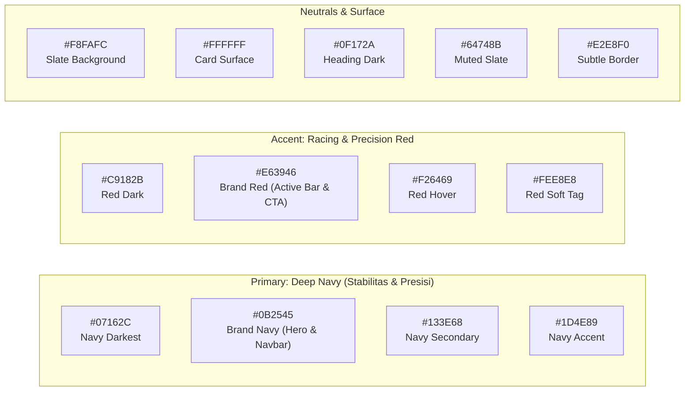

# 07 — Design System & Wireframe (Multitech Clean Glass & Print System)

## 1. Evolusi Desain: Konsep Awal ke Sistem Visual Aktual
Pada tahap Sprint 0, konsep warna awal menggabungkan *Navy Gelap* (`#0B2545`) dengan aksen *Merah* (`#E63946`). Pada implementasi akhir, antarmuka web dan tata letak cetak disempurnakan mengacu pada prinsip **Clean Studio / Anti-Card-Slop** ([DESIGN.md](../DESIGN.md)):

- **Permukaan Aplikasi Web (Light & Dark Mode via `next-themes`):** Kanvas Apple Cool Grey `#F2F2F7` (Light) dan hitam OLED `#000000` (Dark), panel putih bersih / *Liquid Glass* (`.ios-glass-card`, `.ios-glass-inner`) hanya pada elemen mengambang/overlay, pemisah garis tipis `1px hairline`, judul ber-*negative letter-spacing*, angka `tabular-nums`, dan ikon vektor `lucide-react`.
- **Dokumen Cetak (Nota Servis & Laporan Keuangan):** Memakai tata letak cetak datar **Minimal Hairline (Opsi A)** di atas kertas putih A4 (`PrintableServiceReceipt.tsx` dan `PrintableReportsDocument.tsx`) tanpa tumpukan kartu (*card soup*), sehingga hasil cetak atau ekspor PDF melalui `window.print()` terbaca tajam baik berwarna maupun hitam-putih.

---

## 2. Palet Warna (Referensi Awal & Token Aktual `globals.css`)



### Konfigurasi Tailwind (`tailwind.config.ts`)
```typescript
export const multitechColors = {
  navy: {
    DEFAULT: '#0B2545', // Warna utama navbar, hero, header kanban
    dark: '#07162C',    // Background footer & dark surfaces
    light: '#133E68',   // Border kontras & hover card
  },
  crimson: {
    DEFAULT: '#E63946', // Garis aksen aktif, badge status urgent, tombol utama
    hover: '#C9182B',   // State hover CTA
    light: '#FEE8E8',   // Latar belakang badge / alert info
  },
  surface: {
    bg: '#F8FAFC',      // Background canvas publik & dashboard
    card: '#FFFFFF',    // Kontainer kartu servis
    muted: '#F1F5F9',   // Background input & strip antrean
  },
  status: {
    waiting: { bg: '#FEF3C7', text: '#92400E', border: '#FDE68A' }, // Kuning (Menunggu)
    process: { bg: '#E0E7FF', text: '#3730A3', border: '#C7D2FE' }, // Biru/Indigo (Perbaikan/Solder)
    testing: { bg: '#F3E8FF', text: '#6B21A8', border: '#E9D5FF' }, // Ungu (Uji/QC)
    ready:   { bg: '#DCFCE7', text: '#166534', border: '#BBF7D0' }, // Hijau (Siap Diambil)
    cancel:  { bg: '#FEE2E2', text: '#991B1B', border: '#FECACA' }, // Merah (Batal/Gagal)
  }
};
```

---

## 3. Tipografi
- **Font Utama:** `Plus Jakarta Sans` atau `Inter` (Sans-serif modern, mudah dibaca pada layar kecil teknisi maupun pelanggan).
- **Font Monospace:** `JetBrains Mono` untuk kode servis 4-digit, nomor part ECU, dan serial modul.
- **Skala Hirarki:**
  - H1: `text-3xl md:text-4xl font-extrabold tracking-tight` (Judul Halaman / Hero)
  - H2: `text-xl md:text-2xl font-bold` (Nama Modul, Section Header)
  - H3 / Tagline: `text-xs md:text-sm font-semibold tracking-wider uppercase text-crimson` (Label kategori kecil)
  - Body: `text-sm md:text-base text-slate-700 leading-relaxed`

---

## 4. Komponen Kustom Utama (Pure Tailwind)

### 4.1 Kartu Antrean Publik (Anonim)
Komponen kartu untuk web publik tanpa memperlihatkan data sensitif (nama/nomor plat):
```html
<div class="rounded-xl border border-slate-200 bg-white p-5 shadow-sm hover:shadow-md transition-shadow">
  <div class="flex items-center justify-between border-b border-slate-100 pb-3">
    <span class="text-xs font-semibold uppercase tracking-wider text-crimson">
      Masuk: 03 Okt 2026
    </span>
    <span class="inline-flex items-center rounded-full bg-indigo-100 px-2.5 py-0.5 text-xs font-medium text-indigo-800">
      Perbaikan
    </span>
  </div>
  <div class="mt-4">
    <h3 class="text-lg font-bold text-navy">Toyota Avanza (2015)</h3>
    <div class="mt-2 flex flex-wrap gap-1.5">
      <span class="rounded bg-slate-100 px-2 py-0.5 text-xs font-mono text-slate-700">Modul: ECU Denso</span>
      <span class="rounded bg-slate-100 px-2 py-0.5 text-xs font-mono text-slate-700">Speedometer</span>
    </div>
  </div>
  <button class="mt-5 w-full rounded-lg bg-navy py-2.5 text-center text-xs font-semibold text-white hover:bg-navy-light transition-colors">
    Cek Progres Detail &rarr;
  </button>
</div>
```

### 4.2 Stepper Progres Servis (Timeline Visual)
Status per modul dengan ikon status dan garis alur interaktif:
1. **Diterima** (Hijau centang)
2. **Diagnosa** (Hijau centang)
3. **Perbaikan** (Biru aktif berkedip)
4. **Uji / QC** (Abu-abu standby)
5. **Siap Diambil** (Abu-abu standby)

---

## 5. Wireframe Konseptual

### 5.1 Web Pelanggan — Halaman Beranda & Papan Antrean
```text
+-----------------------------------------------------------------------+
| [ MULTITECH ]                                   Beranda  Cek Progres  |
+-----------------------------------------------------------------------+
|  HERO BANNER (Background: Brand Navy #0B2545)                         |
|  PAPAN PANTAU PROGRES SERVIS ELEKTRONIK MOBIL                         |
|  Transparansi perbaikan ECU, BCM, EPS, dan Speedometer di Tasikmalaya |
|                                                                       |
|  [ Cari berdasarkan merek mobil / jenis modul... ] [ Filter Status v ]|
+-----------------------------------------------------------------------+
|                                                                       |
|  ANTREAN UNIT AKTIF (Anonim & Real-Time)                              |
|                                                                       |
|  +------------------------+  +------------------------+               |
|  | Masuk: 03 Okt | [PROSES]|  | Masuk: 04 Okt | [QC]   |               |
|  | Toyota Avanza 2015     |  | Honda Jazz RS 2018     |               |
|  | Modul: ECU             |  | Modul: EPS Module      |               |
|  | [ Cek Detail Unit ]    |  | [ Cek Detail Unit ]    |               |
|  +------------------------+  +------------------------+               |
|                                                                       |
+-----------------------------------------------------------------------+
```

### 5.2 Modal Input Verifikasi (Saat Kartu Diklik atau via `/cek/[code]`)
```text
+-------------------------------------------------------+
|              CEK STATUS PROGRES SERVIS                |
|                                                       |
|  Kode Servis (4 Digit)   : [  4  8  2  1  ]           |
|  4 Digit Terakhir No. HP : [  4  8  0  7  ]           |
|                                                       |
|                 [  BUKA PROGRES ->  ]                 |
+-------------------------------------------------------+
```

### 5.3 Web Pelanggan — Halaman Detail Progres (`/track/[publicId]`)
```text
+-----------------------------------------------------------------------+
| <- Antrean                                  #4821 [Salin]  [Perbaikan]|
+-----------------------------------------------------------------------+
| Unit: Toyota Avanza 1.3 Veloz (2018)                                  |
| Mobil Utuh · Datang Langsung · Asep Suryana                           |
+-----------------------------------------------------------------------+
| MODUL 1: ECU (Engine Control Unit)           [Garansi 3 Bln]          |
| [v Diterima] -> [v Diagnosa] -> [* Pengerjaan] -> [o QC] -> [o Selesai]|
|                                                                       |
| LINIMASA PROGRES & FOTO PUBLIK:                                       |
| - 22 Nov 14:20 : Penggantian IC driver coil & solder ulang jalur PCB.  |
|   [ Foto Bukti Tahap Pengerjaan ]                                     |
+-----------------------------------------------------------------------+
| RINCIAN BIAYA & PEMBAYARAN                                            |
| Total Biaya : Rp 950.000   |  Terbayar: Rp 300.000 (DP)               |
| Sisa Tagihan: Rp 650.000                                              |
|                                                                       |
| [ Cetak / Simpan Nota (Minimal Hairline) ]   [ Konfirmasi WhatsApp ]  |
+-----------------------------------------------------------------------+
```

### 5.4 Web Admin — Dashboard Operasional & Laporan Keuangan
```text
+-----------------------------------------------------------------------+
| MULTITECH ADMIN | Dashboard | Servis | Pelanggan | Laporan | Keluar   |
+-----------------------------------------------------------------------+
| KPI Strip (Antrean Aktif · Siap Diambil · Terlambat · Total Tagihan)  |
+----------------------------------+------------------------------------+
| Unit Aktif Terbaru (Max 5)       | Top 3 Prioritas Tindak Lanjut      |
| - #4821 Avanza · Pengerjaan      | - Catatan pengingat & deadline     |
| - #9102 Jazz   · Diagnosa        |                                    |
+----------------------------------+------------------------------------+
| Grafik Kepadatan & Realisasi Bulanan (GroupedBarChart)                |
+-----------------------------------------------------------------------+
```
