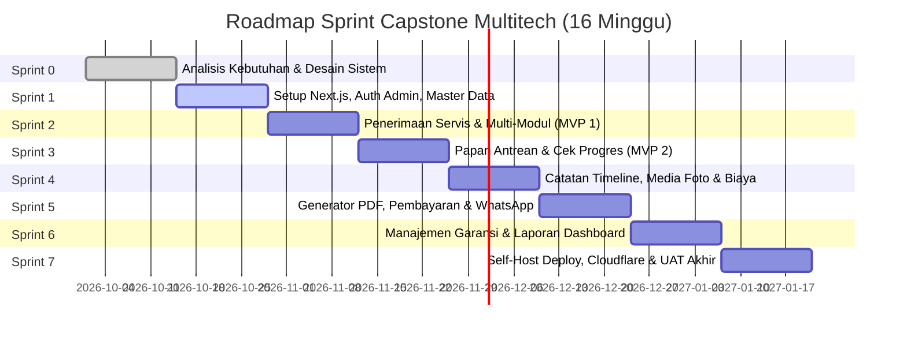

# 08 — Product Backlog & Rencana Sprint (Scrum)

## 1. Metodologi Pengembangan: Scrum
Pengembangan dilakukan menggunakan kerangka kerja **Scrum** dengan durasi sprint **2 minggu per sprint** selama total **16 minggu (8 Sprint: Sprint 0 s.d. Sprint 7)**.

- **Tim:** 2–3 Orang Mahasiswa Capstone
- **Product Owner & Mitra:** Multitech (Tasikmalaya)
- **Scrum Master & Tim Pengembang:** Mahasiswa Capstone

---

## 2. Product Backlog Items (PBI) & Story Points

Estimasi menggunakan deret Fibonacci (*Planning Poker*): 1, 2, 3, 5, 8, 13.

| ID | Kategori | User Story | Prioritas | SP | Target Sprint |
|---|---|---|---|---|---|
| US-01 | Analisis | Sebagai tim, kami membutuhkan dokumen PRD, SRS, ERD, dan diagram UML agar arah arsitektur terdefinisi jelas. | High | 5 | Sprint 0 |
| US-02 | Pondasi | Sebagai admin, saya ingin login menggunakan kredensial aman agar akses dashboard terlindungi. | High | 3 | Sprint 1 |
| US-03 | Master Data | Sebagai admin, saya ingin mengelola master data pelanggan & kendaraan (termasuk VIN) agar data servis terstruktur (`module_types` via seed). | High | 5 | Sprint 1 |
| US-04 | Penerimaan | Sebagai admin, saya ingin menginput penerimaan servis (multi-modul, kategori otomotif/genset, ekspedisi/resi) dan menghasilkan kode 4-digit acak unik. | High | 8 | Sprint 2 |
| US-05 | Status Modul | Sebagai admin, saya ingin memperbarui status tahapan tiap modul secara independen sesuai alur standar (`BR-03`). | High | 5 | Sprint 2 |
| US-06 | Papan Publik | Sebagai pengunjung/pelanggan, saya ingin melihat papan antrean mobil yang sedang diservis secara anonim tanpa login. | High | 8 | Sprint 3 |
| US-07 | Cek Progres | Sebagai pelanggan, saya ingin memverifikasi kode 4-digit + 4 digit HP (manual atau prefill `/cek/[code]`) untuk melihat detail progres kendaraan. | High | 5 | Sprint 3 |
| US-08 | Timeline & Foto | Sebagai admin, saya ingin mengunggah foto bukti terkompresi (`/api/media`) dengan toggle publik/privat agar pelanggan dapat melihat progres secara aman. | Medium | 8 | Sprint 4 |
| US-09 | Rincian Biaya | Sebagai admin, saya ingin menambahkan rincian biaya (jasa/sparepart/diagnosa) bertahap hingga status modul final (`BR-07`). | High | 5 | Sprint 4 |
| US-10 | Cetak Nota | Sebagai admin & pelanggan, saya ingin mencetak atau menyimpan PDF nota tanda terima berformat Minimal Hairline (`window.print()`). | Medium | 5 | Sprint 5 |
| US-11 | Pembayaran | Sebagai admin, saya ingin mencatat pembayaran DP/lunas (tunai/transfer/QRIS) dengan kalkulasi otomatis (`BR-05`, `BR-06`). | High | 5 | Sprint 5 |
| US-12 | WhatsApp Link | Sebagai admin, saya ingin menekan tombol WhatsApp yang otomatis membuka template chat ke pelanggan tanpa API berbayar. | Medium | 3 | Sprint 5 |
| US-13 | Garansi Servis | Sebagai admin, saya ingin menetapkan masa garansi per modul dan memproses klaim garansi terkait (`BR-08`). | High | 5 | Sprint 6 |
| US-14 | Dashboard & Laporan | Sebagai pemilik, saya ingin melihat KPI, prioritas tindak lanjut, grafik pendapatan, modul & mitra terbanyak, serta ekspor CSV/PDF. | Medium | 8 | Sprint 6 |
| US-15 | Rilis & Deploy | Sebagai tim, kami ingin mendeploy sistem ke server Ubuntu di rumah menggunakan Docker & Cloudflare Tunnel. | High | 8 | Sprint 7 |
| US-16 | Pengujian & UAT | Sebagai tim, kami ingin melakukan uji Black Box dan UAT bersama pihak Multitech untuk mengukur skor SUS. | High | 5 | Sprint 7 |

**Total Story Points:** 91 SP  
**Kecepatan Rata-rata (*Velocity*):** ± 11–13 SP per sprint.

---

## 3. Rencana Sprint (Sprint Roadmap)

### Rincian Tujuan Sprint (Sprint Goals):
- **Sprint 0 (Minggu 1–2):** Finalisasi dokumen spesifikasi (PRD, SRS, ERD, Use Case, Activity Diagram, Arsitektur, Wireframe).
- **Sprint 1 (Minggu 3–4):** Inisialisasi repositori, skema Prisma, login admin JWT (`bcryptjs` + `jose`), serta CRUD pelanggan dan kendaraan (termasuk VIN).
- **Sprint 2 (Minggu 5–6):** Fitur input penerimaan unit servis (mobil utuh/modul/genset, datang/ekspedisi), pembuatan kode 4-digit unik (`BR-01`), dan manajemen status berurutan (`BR-03`).
- **Sprint 3 (Minggu 7–8):** Papan antrean publik anonim, verifikasi `/cek` & `/cek/[code]` + 4 digit HP, dan detail pelacakan `/track/[publicId]`.
- **Sprint 4 (Minggu 9–10):** Catatan tahap teknisi, kompresi foto di browser (Canvas) & penyimpanan lokal aman (`/api/media`), toggle visibilitas publik/privat, serta rincian biaya.
- **Sprint 5 (Minggu 11–12):** Tata letak cetak Nota & Laporan datar Minimal Hairline via `window.print()`, pencatatan transaksi pembayaran + validasi `BR-06`/`BR-07`, serta integrasi tautan `wa.me`.
- **Sprint 6 (Minggu 13–14):** Masa berlaku garansi (`warrantyUntil`), pembuatan order klaim garansi (`BR-08`), Dashboard KPI & Top 3 Prioritas, laporan bulanan, Top Modul/Mitra, dan Ekspor CSV aman injeksi formula.
- **Sprint 7 (Minggu 15–16):** Uji unit aturan bisnis (`tests/business-rules.test.ts`), uji produksi PostgreSQL 18 end-to-end di browser, dan persiapan dokumentasi deployment (`docker-compose.yml`).

---

## 4. Definition of Done (DoD)
Setiap *Product Backlog Item* dinyatakan **Selesai (Done)** apabila memenuhi kriteria berikut:
1. Kode sumber ditulis dalam TypeScript *strict mode* dan bebas dari pesan kesalahan linter/build.
2. Migrasi skema Prisma telah diuji pada basis data lokal dan terdokumentasi.
3. Kebutuhan fungsional lulus uji skenario Black Box pengujian.
4. Tampilan responsif pada ukuran layar mobile (minimal lebar 360px) dan desktop.
5. Perubahan kode telah di-commit dengan format *Conventional Commits* dan digabungkan ke cabang utama melalui Pull Request yang ditinjau rekan tim.
