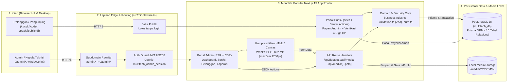
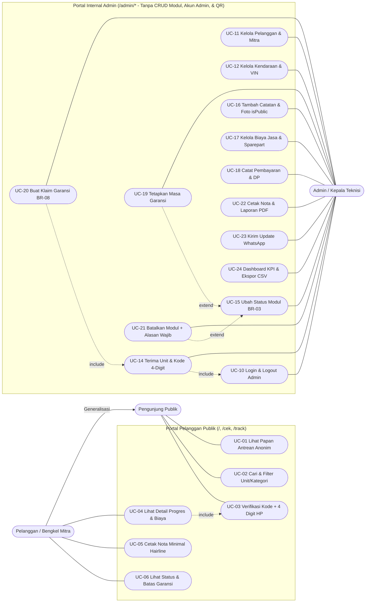
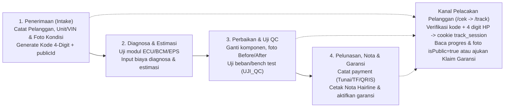
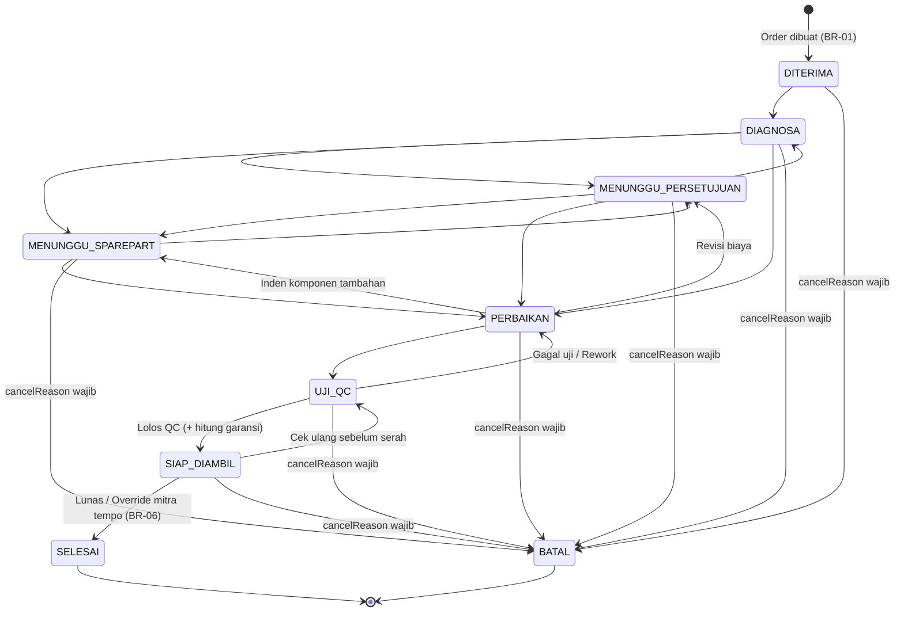
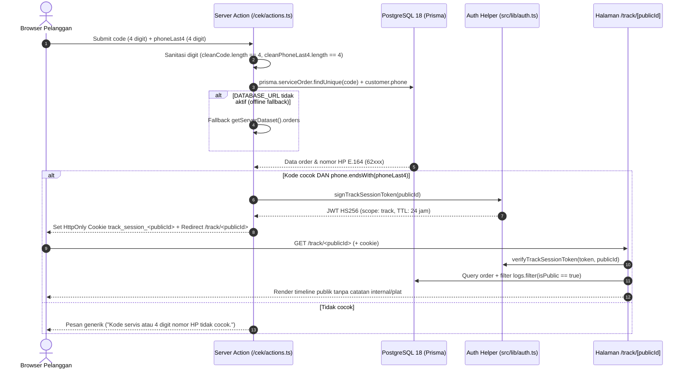
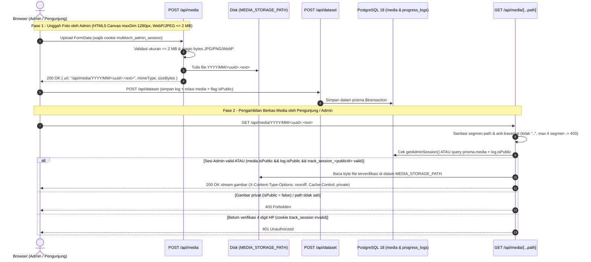

# 11 - Bahan Teknis Laporan Capstone Project UNSIL 2026

Dokumen ini mengompilasi seluruh bahan teknis, diagram arsitektur/desain (dalam sintaks Mermaid), matriks keterlacakan kebutuhan, ringkasan pengujian terverifikasi, serta indeks potongan kode penting untuk menyusun **Laporan Akhir Capstone Project Informatika Universitas Siliwangi 2026 (`FT.IF-AKD-F.A.05.2`, Suplemen S-7)**.

Seluruh isi dokumen ini disinkronkan secara langsung dengan kondisi aktual basis kode pada repositori **Sistem Informasi Pelacakan & Manajemen Servis CV Multitech Tasikmalaya** dan **tidak** menyertakan fitur di luar lingkup rilis v1 (`CRUD Master Jenis Modul UI`, `Manajemen Akun Admin UI`, `QR Code`).

---

## A. Ringkasan Data Umum Proyek (Bahan `Tabel i`)

| Komponen | Nilai / Keterangan |
|---|---|
| Nama Produk & Versi | **Multitech Service Tracker** (`v0.1.0`) |
| Mitra & Pengguna Utama | **CV Multitech** (Jl. Noenoeng Tisnasaputra, Kahuripan, Kec. Tawang, Kota Tasikmalaya); Admin/Kepala Teknisi bengkel, Pelanggan Perorangan, dan Bengkel Mitra (B2B) |
| Platform Target | Aplikasi Web Responsif (Desktop & Mobile Browser) |
| Arsitektur & Stack | Next.js 15 App Router (TypeScript), React 19, Tailwind CSS, Prisma ORM 6, PostgreSQL 18 (Lokal) / PostgreSQL 16 (Docker Compose) |
| Repositori Kode | [`https://github.com/feb027/Capstone_Multitech`](https://github.com/feb027/Capstone_Multitech) (Branch: `main`) |
| Berkas Spesifikasi | [`docs/01-PRD.md`](01-PRD.md) hingga [`docs/10-referensi.md`](10-referensi.md) |
| Kontainerisasi | [`Dockerfile`](../Dockerfile) & [`docker-compose.yml`](../docker-compose.yml) *(catatan: file container telah disiapkan; eksekusi build image Docker belum diuji terhadap daemon Docker lokal)* |

---

## B. Bahan Bab I - Ruang Lingkup & Perubahan dari Proposal (`Tabel 1.2` & `Tabel 1.3`)

### B.1 Bahan `Tabel 1.2` - Ruang Lingkup Proyek

| Termasuk Lingkup (Direalisasikan di v1) | Di Luar Lingkup / Batasan Rilis v1 |
|---|---|
| Papan antrean publik anonim (`/`) bebas data pribadi (tanpa nama, nomor HP, plat nomor, atau kode servis) dengan pencarian & filter | Antarmuka web CRUD Master Jenis Modul (`FR-A06`); pengisian jenis modul dikelola melalui skrip seed [`prisma/seed.ts`](../prisma/seed.ts) |
| Verifikasi 2 faktor ringan (`/cek`, `/cek/[code]`) via kode servis 4 digit unik + 4 digit akhir nomor HP & cookie `track_session_<publicId>` 24 jam | Antarmuka manajemen multi-akun admin & ubah kata sandi (`FR-A02`); otorisasi menggunakan akun admin aktif berbasis database/seed |
| Detail pelacakan real-time (`/track/[publicId]`), progres per modul independen, rincian biaya/pembayaran, estimasi, dan garansi | Pencantuman QR Code (`FR-S13`) pada nota PDF; akses cepat memakai tautan langsung `/cek/[code]` |
| Portal internal admin (`/admin/*`) untuk manajemen pelanggan & kendaraan (termasuk VIN), penerimaan multi-modul, alur status 9 tahap (`BR-03`), foto Before/After terisolasi `isPublic`, rincian biaya & pembayaran bertahap, serta klaim garansi (`BR-08`) | Unggah berkas video pada catatan progres (`media.kind = VIDEO` ada di skema, hanya gambar JPG/PNG/WebP `<= 2 MB` yang diizinkan handler unggah) |
| Cetak Nota Servis Resmi & Rekap Laporan Keuangan tata letak datar **Minimal Hairline (Opsi A)** via `window.print()`, integrasi pesan `wa.me`, serta Dashboard KPI + grafik bulanan + Ekspor CSV aman injeksi | Metrik rata-rata durasi pengerjaan per modul & rasio klaim garansi otomatis (`FR-D06`) serta polling otomatis antrean publik (`FR-P04`) |

### B.2 Bahan `Tabel 1.3` - Perubahan dari Rencana Awal ke Realisasi

| Komponen | Rencana Awal / Proposal | Realisasi Aktual | Alasan Perubahan |
|---|---|---|---|
| Mesin Basis Data | SQLite / penyimpanan prototipe awal | **PostgreSQL 18** (`multitech_db`) via Prisma ORM (`10` tabel) + opsi Compose PostgreSQL 16 | Menjamin integritas relasional multi-tabel, transaksi atomik `$transaction`, ketersediaan tipe enum native, serta kesesuaian lingkungan produksi bengkel |
| Generator Cetak Nota & Laporan | Library `@react-pdf/renderer` (render PDF terpisah) | Dialog cetak native browser (`window.print()`) dengan komponen khusus `@media print` bergaya **Minimal Hairline Opsi A** ([`PrintableServiceReceipt.tsx`](../src/components/shared/PrintableServiceReceipt.tsx) & [`PrintableReportsDocument.tsx`](../src/components/admin/PrintableReportsDocument.tsx)) | Menghilangkan ketidaksinkronan tata letak antara pratinjau layar dan hasil cetak A4 sekaligus memangkas ukuran bundle |
| Pengolahan & Penyimpanan Foto | Library server-side `sharp` + penyimpanan lokal | Kompresi HTML5 Canvas sisi klien menjadi WebP/JPEG (`maxDim 1280px`, kualitas `0,78`, batas `<= 2 MB`) di [`service-utils.ts`](../src/components/admin/services/service-utils.ts), disimpan via `POST /api/media` dengan verifikasi *magic bytes* & dilayani terproteksi via `GET /api/media/[...path]` | Menghindari dependensi biner native `sharp` lintas OS sekaligus menegakkan isolasi privasi `isPublic` dan sesi admin/pelanggan per permintaan berkas |
| Tampilan Monitoring Admin | Papan Kanban drag-and-drop | Tabel terstruktur bernilai tinggi + panel **Top 3 Prioritas Tindak Lanjut** + penanda urgensi keterlambatan + `GroupedBarChart` pada `/admin/dashboard` | Lebih padat informasi dan cepat dipindai saat mengelola unit paralel dibanding kartu Kanban |
| Manajemen Master Modul, Akun Admin & QR Code | UI manajemen modul (`FR-A06`), multi-admin (`FR-A02`), dan QR Code nota (`FR-S13`) | Dikeluarkan dari lingkup v1 sesuai arahan pemilik proyek; master jenis modul dikelola melalui seed [`prisma/seed.ts`](../prisma/seed.ts) dan tautan pelacakan memakai URL langsung `/cek/[code]` | Memfokuskan aplikasi pada alur inti bengkel dan menjaga kesederhanaan operasi admin harian |

---

## C. Bahan Bab II - Teknologi yang Digunakan (`Tabel 2.2`)

Seluruh versi pustaka di bawah diambil langsung dari [`package.json`](../package.json) dan lingkungan eksekusi lokal terverifikasi:

| Komponen | Teknologi dan Versi | Peran & Alasan Pemilihan |
|---|---|---|
| Framework Full-Stack | **Next.js** `^15.1.4` (App Router) & **React** `^19.0.0` | Mendukung Server Components untuk proyeksi data publik bebas kebocoran PII (`/` dan `/track/[publicId]`), Server Actions, dan Route Handlers dalam satu monolith modular |
| Bahasa Pemrograman | **TypeScript** `^5.7.3` | Memberikan keamanan tipe statis menyeluruh dari skema Prisma hingga komponen antarmuka dan pengujian aturan bisnis |
| Styling & Ikon | **Tailwind CSS** `^3.4.17`, `clsx` `^2.1.1`, `tailwind-merge` `^2.6.0`, `lucide-react` `^0.469.0`, `next-themes` `^0.4.4` | Membangun tata letak responsif dengan permukaan panel terpadu (1px hairline divider), dukungan dark/light mode, serta aturan `@media print` A4 presisi |
| ORM & Basis Data | **Prisma ORM** `^6.1.0` (`@prisma/client` & `prisma`) + **PostgreSQL 18** (`127.0.0.1:5432`) / `postgres:16-alpine` (Docker) | Skema deklaratif (`10` tabel), migrasi terstruktur, transaksi atomik (`$transaction`), dan proteksi *foreign key* relasional |
| Autentikasi & Sesi | **jose** `^5.9.6` (JWT HS256) & **bcryptjs** `^2.4.3` | Cookie `HttpOnly` bertanda tangan kriptografis (`multitech_admin_session` 7 hari; `track_session_<publicId>` 24 jam) serta hash kata sandi bcrypt cost 10 |
| Validasi Skema Data | **Zod** `^4.6.7` | Validasi input ketat pada [`src/lib/validation.ts`](../src/lib/validation.ts) untuk pelanggan, kendaraan (VIN), order, modul, item biaya, dan pembayaran |
| Unit Test Runner | **tsx** `^4.19.2` + `node:test` / `node:assert` | Eksekusi langsung unit test TypeScript pada [`tests/business-rules.test.ts`](../tests/business-rules.test.ts) tanpa kompilasi terpisah |

---

## D. Bahan Bab III - Analisis, Desain Arsitektur, Diagram & Keamanan

### D.1 Bahan `Tabel 3.2` - Matriks Keterlacakan Kebutuhan (`UN -> FR -> F -> Berkas/Simbol -> TC`)

| ID Kebutuhan | Ringkasan Kebutuhan | Prioritas | Fitur / Berkas Implementasi Utama | Kasus Uji Terkait | Status |
|---|---|---|---|---|---|
| `FR-P01`, `FR-P02`, `FR-P03` | Papan antrean publik anonim bebas PII + filter/pencarian unit & kategori | Must / Should | [`src/app/(public)/page.tsx`](../src/app/%28public%29/page.tsx), [`PublicQueueClient.tsx`](../src/components/public/PublicQueueClient.tsx) | `TC-05` | Selesai |
| `FR-P04` | Polling otomatis pembaruan antrean publik | Could | Menggunakan `force-dynamic` saat pemuatan ulang halaman | - | Ditunda |
| `FR-P05`, `FR-P06`, `FR-P13` | Verifikasi 4-digit kode + 4-digit akhir HP, tautan prefill `/cek/[code]`, cookie `track_session` | Must / Should | [`src/app/(public)/cek/actions.ts`](../src/app/%28public%29/cek/actions.ts) (`verifyCustomerAccessAction`), [`src/lib/auth.ts`](../src/lib/auth.ts) | `TC-02`, `TC-03`, `TC-04`, `TC-19` | Selesai |
| `FR-P07`..`FR-P12` | Detail progres per modul (hanya log/foto publik), biaya, estimasi, garansi, cetak nota pelanggan | Must | [`src/app/(public)/track/[publicId]/page.tsx`](../src/app/%28public%29/track/[publicId]/page.tsx), [`PrintableServiceReceipt.tsx`](../src/components/shared/PrintableServiceReceipt.tsx) | `TC-08`, `TC-09`, `TC-14` | Selesai |
| `FR-A01` | Login & logout admin (bcrypt + JWT HS256 + Middleware guard) | Must | [`src/app/(admin)/admin/actions.ts`](../src/app/%28admin%29/admin/actions.ts), [`src/middleware.ts`](../src/middleware.ts), [`src/lib/auth.ts`](../src/lib/auth.ts) | Audit Middleware & E2E Login | Selesai |
| `FR-A03`, `FR-A04`, `FR-A05` | CRUD pelanggan (Perorangan/Mitra), pencarian, & CRUD kendaraan termasuk VIN | Must | [`AdminCustomersClient.tsx`](../src/app/%28admin%29/admin/customers/AdminCustomersClient.tsx), [`src/lib/dataset-store.ts`](../src/lib/dataset-store.ts) | `TC-16`, Validasi Zod `BR-01` | Selesai |
| `FR-S01`, `FR-S02`, `FR-S03` | Penerimaan unit (Datang/Ekspedisi + resi), multi-modul, generate kode 4-digit unik acak (`BR-01`) | Must | [`ServiceIntakeModal.tsx`](../src/components/admin/services/ServiceIntakeModal.tsx), `generateUniqueOrderCode`, `upsertServerOrder` | `TC-01` | Selesai |
| `FR-S04`, `FR-S05`, `FR-S06` | Transisi status modul (`BR-03`), catatan progres, & unggah foto terkompresi via `/api/media` dengan isolasi `isPublic` | Must | [`ServiceEditForm.tsx`](../src/components/admin/services/ServiceEditForm.tsx), [`src/lib/business-rules.ts`](../src/lib/business-rules.ts), [`src/app/api/media/route.ts`](../src/app/api/media/route.ts), [`[...path]/route.ts`](../src/app/api/media/[...path]/route.ts) | `TC-06`, `TC-07`, `TC-08`, `TC-09` | Selesai |
| `FR-S07`, `FR-S08`, `FR-S10` | Manajemen biaya (`BR-07` lock final), pembayaran bertahap (`BR-05`), & pembatalan dengan alasan wajib (`BR-06`) | Must | [`business-rules.ts`](../src/lib/business-rules.ts) (`calculateBillingSummary`, `validateOrderRules`), [`dataset-store.ts`](../src/lib/dataset-store.ts) | `TC-10`, `TC-11`, `TC-12`, `TC-18` | Selesai |
| `FR-S09`, `FR-S11` | Penetapan durasi garansi otomatis & pembuatan Klaim Garansi tertaut (`BR-08`) | Must | `computeWarrantyUntil`, `isWarrantyEligible`, `createServerWarrantyClaim` | `TC-13` | Selesai |
| `FR-S12`, `FR-S14`, `FR-S15` | Pembaruan estimasi & pengingat prioritas, cetak nota A4 Minimal Hairline, tautan WhatsApp `wa.me` | Must / Should | [`ServiceDetailView.tsx`](../src/components/admin/services/ServiceDetailView.tsx), [`PrintableServiceReceipt.tsx`](../src/components/shared/PrintableServiceReceipt.tsx), `getWaLink` | `TC-14`, `TC-15` | Selesai |
| `FR-D01`..`FR-D05`, `FR-D07` | Dashboard 4 KPI, Top 3 Prioritas, penanda urgensi, laporan periode, statistik modul/mitra, cetak laporan, ekspor CSV aman injeksi | Must / Should | [`AdminDashboardClient.tsx`](../src/components/admin/AdminDashboardClient.tsx), [`AdminReportsClient.tsx`](../src/components/admin/AdminReportsClient.tsx), `escapeCsvCell` | `TC-17` & E2E Dashboard/Laporan | Selesai |
| `FR-D06` | Rata-rata durasi pengerjaan & rasio klaim garansi per jenis modul | Could | Belum diimplementasikan pada agregasi laporan v1 | - | Ditunda |
| `FR-A02`, `FR-A06`, `FR-S13` | UI Multi-Admin, UI CRUD Jenis Modul, & QR Code di nota | Out of Scope | Sengaja dikeluarkan dari rilis v1 (lihat `Tabel 1.3`) | - | Di Luar Lingkup |

---

### D.2 Diagram Arsitektur Sistem (Bahan `Gambar 3.1` - C4 Container View)



---

### D.3 Diagram Use Case Sistem (Bahan `Lampiran 7` / Analisis Kebutuhan)



---

### D.4 Rancangan Basis Data Relasional 10 Tabel (Bahan `Gambar 3.2`)

Skema di bawah disinkronkan baris per baris dengan [`prisma/schema.prisma`](../prisma/schema.prisma):

```mermaid
erDiagram
    admins {
        string id PK
        string name
        string email UK
        string password_hash
        boolean is_active
        datetime created_at
    }

    customers {
        string id PK
        string name
        string phone UK "Format 62xxx"
        enum type "PERORANGAN | MITRA"
        string workshop_name
        string address
        string notes
        datetime created_at
    }

    vehicles {
        string id PK
        string customer_id FK
        string brand
        string model
        int year
        string plate_number "Privat tidak tampil publik"
        string vin
    }

    module_types {
        string id PK
        string name UK
        string description
        int default_warranty_months
        boolean is_active
    }

    service_orders {
        string id PK
        string public_id UK
        char4 code UK "4 digit acak permanen"
        string customer_id FK
        string vehicle_id FK
        enum intake_type "MOBIL_UTUH | MODUL_SAJA"
        enum entry_method "DATANG | EKSPEDISI"
        string unit_category
        string tracking_number
        string condition_notes
        string priority_note
        string custom_photo_url
        datetime received_at
        datetime estimated_done_at
        datetime handed_over_at
        boolean is_warranty_claim
        string warranty_source_item_id FK
        string created_by
        datetime created_at
        datetime updated_at
    }

    service_items {
        string id PK
        string order_id FK
        string module_type_id FK
        string module_detail
        string complaint
        enum status "9 status BR-03"
        int warranty_months
        datetime warranty_until
        string cancel_reason
        string override_reason
        datetime finished_at
        string before_photo_url
        string after_photo_url
        string before_caption
        string after_caption
    }

    progress_logs {
        string id PK
        string item_id FK
        enum kind "STATUS | NOTE | ESTIMATE"
        enum from_status
        enum to_status
        string note
        boolean is_public
        string created_by
        datetime created_at
    }

    media {
        string id PK
        string log_id FK
        string file_path
        string mime_type
        enum kind "FOTO | VIDEO"
        int size_bytes
        boolean is_public
        datetime created_at
    }

    charge_lines {
        string id PK
        string order_id FK
        string item_id FK
        enum kind "JASA | SPAREPART | DIAGNOSA"
        string description
        int qty
        float unit_price
        datetime created_at
    }

    payments {
        string id PK
        string order_id FK
        float amount
        enum method "TUNAI | TRANSFER | QRIS"
        datetime paid_at
        string note
        string created_by
    }

    customers ||--o{ vehicles : "memiliki"
    customers ||--o{ service_orders : "mengajukan"
    vehicles |o--o{ service_orders : "dirujuk pada"
    service_orders ||--|{ service_items : "memuat"
    module_types ||--o{ service_items : "mengkategorikan"
    service_items |o--o{ service_orders : "sumber klaim garansi"
    service_items ||--o{ progress_logs : "mencatat riwayat"
    progress_logs ||--o{ media : "melampirkan bukti"
    service_orders ||--o{ charge_lines : "menagihkan"
    service_items |o--o{ charge_lines : "rincian per modul"
    service_orders ||--o{ payments : "menerima pembayaran"
    admins ..o{ service_orders : "created_by (audit string)"
```

---

### D.5 Alur Proses Bisnis & State Machine Status Modul `BR-03` (Bahan `Gambar 3.3`)

#### D.5.1 Alur Operasional Servis End-to-End



#### D.5.2 State Machine Status Item Servis (`ALLOWED_STATUS_TRANSITIONS` - `BR-03`)

Sesuai implementasi aktual pada [`src/lib/business-rules.ts`](../src/lib/business-rules.ts#L6-L49):



---

### D.6 Sequence Diagram Alur Keamanan Kritis (`track_session` & Isolasi Media `isPublic`)

#### D.6.1 Autentikasi Pelanggan & Penerbitan Cookie `track_session`



#### D.6.2 Unggah Media Terkompresi & Penegakan Gate `GET /api/media/[...path]`



---

### D.7 Bahan `3.8` - Rancangan Keamanan Sistem

Ringkasan kontrol keamanan yang diimplementasikan dan dapat langsung dijadikan isi Subbab 3.8:

1. **Isolasi Akses & Subdomain Guard ([`src/middleware.ts`](../src/middleware.ts)):**
   - Rute `/admin/*`, subdomain `admin.*`, dan `/api/dataset` memverifikasi token JWT cookie `multitech_admin_session`. Permintaan tidak terautentikasi ke `/admin/*` diarahkan ke `/admin/login`, sedangkan ke `/api/dataset` langsung mendapat `401 Unauthorized`.
2. **Kriptografi Sesi & Kredensial ([`src/lib/auth.ts`](../src/lib/auth.ts)):**
   - Password admin di-hash dengan `bcryptjs` (salt rounds `10`).
   - Penandatanganan token memakai HMAC-SHA256 (`HS256` via `jose`) dengan pemisahan klaim `scope: 'admin'` (`7d`) dan `scope: 'track'` (`24h`), disimpan pada cookie `HttpOnly`, `SameSite: 'lax'`, `secure: NODE_ENV === 'production'`. Pada mode produksi (`NODE_ENV === 'production'`), `AUTH_SECRET` wajib terkonfigurasi (`throw Error` bila kosong).
3. **Proteksi Privasi Papan Antrean Publik (`TC-05`):**
   - Server Component `/` hanya memproyeksikan `publicId`, `vehicleBrand`, `vehicleModel`, `vehicleYear`, `intakeType`, `unitCategory`, `receivedAt`, serta nama modul dan status. Data PII (`customerName`, `customerPhone`, `plateNumber`, `vin`, `code`) tidak dikirimkan ke klien.
4. **Keamanan Unggah & Isolasi Media ([`src/app/api/media/route.ts`](../src/app/api/media/route.ts) & [`src/app/api/media/[...path]/route.ts`](../src/app/api/media/%5B...path%5D/route.ts)):**
   - Validasi ukuran `<= 2 MB`, pemeriksaan *magic bytes* biner nyata (`0xFFD8FF` JPEG, `0x89504E47` PNG, `RIFF...WEBP`), penamaan acak `crypto.randomUUID()`, pencegahan path traversal (`resolvedFile.startsWith(mediaRoot + path.sep)`), serta pembatasan akses `isPublic` dan header `X-Content-Type-Options: nosniff`.
5. **Integritas Data & Proteksi Injeksi ([`src/lib/validation.ts`](../src/lib/validation.ts) & [`src/lib/business-rules.ts`](../src/lib/business-rules.ts)):**
   - Query basis data diparameterisasi melalui Prisma ORM (mencegah SQL Injection).
   - Validasi input ketat menggunakan Zod sebelum mutasi database.
   - Ekspor CSV laporan menggunakan `escapeCsvCell` untuk menetralkan awalan karakter rumus berbahaya (`=`, `+`, `-`, `@`, `\t`, `\r`).

---

## E. Bahan Bab IV & Lampiran 9 - Implementasi & Indeks Potongan Kode Penting

### E.1 Bahan `Tabel 4.1` - Lingkungan Pengembangan & Uji

| Komponen | Spesifikasi Aktual |
|---|---|
| Sistem Operasi Pengembangan | Windows 11 Pro (Native, Node.js runtime) |
| Runtime & Package Manager | Node.js / npm (`tsx ^4.19.2`, `eslint ^9.17.0`, TypeScript `5.7.3`) |
| Basis Data Utama | PostgreSQL 18 (`multitech_db` pada `127.0.0.1:5432`, migrasi Prisma `20261124085137_init`) |
| Konfigurasi Container (Siap Pakai) | [`Dockerfile`](../Dockerfile) (Node 22 Alpine multi-stage) + [`docker-compose.yml`](../docker-compose.yml) (`postgres:16-alpine` & `app`, belum diverifikasi live ke daemon Docker) |
| Penyimpanan Media Lokal | Direktori lokal `./media` (`MEDIA_STORAGE_PATH`) dengan volume mapping `/app/media` pada Docker |

### E.2 Indeks Potongan Kode Penting (Bahan `Lampiran 9` - Format `<= 1 Halaman` per Potongan)

Sesuai Pedoman Bagian 4.7.1, Lampiran 9 menampilkan potongan kode inti bernomor baris dengan keterangan fungsi berkas (maks. 1 halaman per berkas):

| No | Berkas & Rentang Baris | Simbol / Fungsi Inti | Fungsi dalam Sistem |
|---|---|---|---|
| 1 | [`src/lib/business-rules.ts`](../src/lib/business-rules.ts#L6-L184) (`L6-L184`) | `ALLOWED_STATUS_TRANSITIONS`, `calculateBillingSummary`, `computeWarrantyUntil`, `validateOrderRules` | Enjin aturan bisnis: state machine `BR-03`, kalkulasi DP/Lunas `BR-05`, masa garansi `BR-08`, kunci `SELESAI` `BR-06`, serta `escapeCsvCell` (`L225-L232`) |
| 2 | [`src/lib/validation.ts`](../src/lib/validation.ts#L22-L175) (`L22-L175`) | `upsertCustomerSchema`, `upsertOrderSchema`, `createWarrantyClaimSchema` | Validasi Zod input pelanggan, format nomor WA, VIN, item servis, dan klaim garansi |
| 3 | [`src/lib/auth.ts`](../src/lib/auth.ts#L23-L100) (`L23-L100`) & [`src/middleware.ts`](../src/middleware.ts#L4-L64) (`L4-L64`) | `signAdminSession`, `signTrackSessionToken`, `verifyTrackSessionToken`, `middleware` | Penandatanganan & verifikasi JWT HS256 untuk sesi admin & pelanggan serta pengamanan rute/subdomain |
| 4 | [`src/app/(public)/cek/actions.ts`](../src/app/%28public%29/cek/actions.ts#L10-L87) (`L10-L87`) | `verifyCustomerAccessAction` | Server Action verifikasi kode 4 digit + 4 digit akhir HP dan penerbitan cookie `track_session_<publicId>` |
| 5 | [`src/app/api/media/route.ts`](../src/app/api/media/route.ts#L9-L78) (`L9-L78`) & [`[...path]/route.ts`](../src/app/api/media/%5B...path%5D/route.ts#L15-L107) (`L15-L107`) | `detectImageType`, `POST`, `GET` | Unggah gambar tervalidasi *magic bytes* `<= 2 MB` serta gerbang akses `isPublic` & pencegahan path traversal |
| 6 | [`src/lib/dataset-store.ts`](../src/lib/dataset-store.ts#L265-L666) (`L265-L666`) & [`src/app/api/dataset/route.ts`](../src/app/api/dataset/route.ts#L50-L134) (`L50-L134`) | `upsertServerOrder`, `createServerWarrantyClaim`, `POST` | Persistensi atomik Prisma `$transaction`, pemeliharaan kode unik 4-digit, kunci biaya `BR-07`, dan pembuatan order klaim garansi |
| 7 | [`src/components/shared/PrintableServiceReceipt.tsx`](../src/components/shared/PrintableServiceReceipt.tsx#L90-L458) & [`PrintableReportsDocument.tsx`](../src/components/admin/PrintableReportsDocument.tsx#L40-L333) | `PrintableServiceReceipt`, `PrintableReportsDocument` | Komponen cetak A4 datar bergaya *Minimal Hairline (Opsi A)* untuk Nota Servis dan Rekap Laporan Keuangan |

---

## F. Bahan Bab V & Lampiran 8 - Pengujian & Kesiapan Evaluasi (`Tabel 5.1`–`5.5`)

### F.1 Bahan `Tabel 5.1` - Strategi & Lingkungan Pengujian Terlaksana

| Jenis Pengujian | Alat / Metode | Lingkup & Kondisi Terakhir | Status |
|---|---|---|---|
| Unit Testing Aturan Bisnis | `npm test` (`tsx --test tests/*.test.ts`) | Menguji 8 kasus pada [`tests/business-rules.test.ts`](../tests/business-rules.test.ts) (`TC-01`, `TC-07`/`BR-03`, `TC-10`/`11`/`BR-05`, `TC-12`/`BR-06`, `BR-07`, `TC-13`/`BR-08`, `BR-01`/Zod, `escapeCsvCell`) | Lulus (`8/8`) |
| Pemeriksaan Statis & Kompilasi | `npx tsc --noEmit`, `npm run lint`, `npm run build` | Pengecekan seluruh file TypeScript, aturan ESLint Next.js, generasi klien Prisma, dan build produksi | Lulus (akan diverifikasi ulang setelah finalisasi dokumentasi) |
| Pengujian Fungsional E2E Browser | Pengujian interaktif pada PostgreSQL 18 aktif | Menguji alur `/`, `/cek/4821`, `/track/[publicId]`, `/admin/*`, unggah foto `/api/media`, isolasi privat/publik (`TC-08`/`TC-09`), persistensi `VIN`, dan klaim garansi `#3417` | Lulus (`0 console error`) |
| UAT Mitra & Kuesioner SUS (`F-26`, `Tabel 5.3`, `5.6`) | Observasi langsung bengkel mitra & instrumen 10 butir SUS (Brooke, 1996) | Instrumen tugas UAT dan 10 pertanyaan SUS siap di [`docs/09-rencana-pengujian.md`](09-rencana-pengujian.md#L45-L76) | **Belum dilaksanakan** (dijadwalkan sebelum finalisasi Bab V) |

### F.2 Bahan `Tabel 5.2` - Rekap Kasus Uji Black Box (`TC-01`..`TC-19`)

Rincian langkah, input, ekspektasi, dan hasil seluruh 19 skenario `TC-01`..`TC-19` tersedia pada [`docs/09-rencana-pengujian.md`](09-rencana-pengujian.md#L16-L42).

---

## G. Checklist Kesiapan Lampiran Resmi Template Laporan UNSIL 2026

| Lampiran | Isi & Sumber | Status Kesiapan Bahan |
|---|---|---|
| Lampiran 7 (`Dokumen Perancangan`) | Spesifikasi PRD/SRS ([`01-PRD.md`](01-PRD.md), [`02-SRS.md`](02-SRS.md)), Use Case ([`03-use-case.md`](03-use-case.md) + `use-case.puml`), Aktivitas/State ([`04-activity-diagram.md`](04-activity-diagram.md)), ERD ([`05-erd-kamus-data.md`](05-erd-kamus-data.md)), Arsitektur/Sequence ([`06-arsitektur.md`](06-arsitektur.md)), Design System ([`07-design-system.md`](07-design-system.md)), dan Diagram Mermaid di dokumen ini | **Siap (Mermaid lengkap)** - ekspor gambar PNG resolusi cetak untuk dokumen Word/LaTeX akan dilakukan saat penyusunan laporan akhir |
| Lampiran 8 (`Dokumen dan Hasil Pengujian`) | [`docs/09-rencana-pengujian.md`](09-rencana-pengujian.md) + hasil `tests/business-rules.test.ts` + catatan E2E | **Siap teknis** (menunggu pengisian tanggal, nama penguji formal, & hasil UAT/SUS mitra) |
| Lampiran 9 (`Potongan Kode & Tautan Repo`) | Indeks berkas inti pada Bagian E.2 di atas + URL GitHub `feb027/Capstone_Multitech` | **Siap** |
| Lampiran 10 (`Manual Pengguna`) | Ringkasan instalasi, env, akun uji, dan panduan rute tersedia di [`README.md`](../README.md); tangkapan layar bertahap untuk naskah akhir disusun kemudian bersama laporan | **Siap dasar** (panduan operasional lengkap dengan tangkapan layar UI dibuat saat penyusunan laporan) |
| Lampiran 1–6 & 11–13 (`F-11`, `F-05`, `F-19`, `F-08`, `F-26`, `F-27`, `F-09`, Turnitin, Foto) | Dokumen administratif, berita acara mitra, lembar bimbingan, dan cek kemiripan jurusan | **Dikelola di luar kode** oleh tim saat penyusunan laporan akhir |
